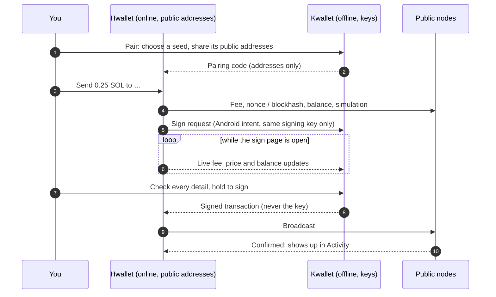

<div align="center">


### An offline vault that signs, and the quickest hot wallet that never holds a key.

[](https://github.com/0xkabeno/Kwallet/releases/latest)
[](https://github.com/0xkabeno/Kwallet/actions/workflows/build.yml)
[](LICENSE)
[](hwallet/LICENSE)


[**Download**](#downloads) · [How it works](#how-signing-works) · [Features](#features) · [Fees](#fees) · [Security](#security-model) · [Build](#build-from-source)

</div>

---

## Two apps, one wallet

| | **Kwallet** — the vault | **Hwallet** — the hot wallet |
|---|---|---|
| Role | Fully secure offline wallet. Creates, stores and **signs** | The quickest hot wallet. Watches, prepares and **broadcasts** |
| Internet | **None.** The APK has no `INTERNET` permission | Public nodes for prices, balances, history and broadcast |
| Keys | Recovery phrases and private keys, encrypted on the device, never leave it | **Public addresses only.** Never sees a key |
| Signing | Every transaction, message and dApp request, on its own sign page: check every detail, hold to sign | Asks Kwallet on the same phone (send, swap, WalletConnect, dApp browser) and waits for the signed result |
| Live data | Receives live fee, price and balance updates from Hwallet while its sign page is open | Live prices, balances, activity, incoming alerts, background service |
| License | MIT | GPL-3.0 (layout and tools follow Gem Wallet) |

Kwallet works alone, as an Android app or as one HTML file you open with the network unplugged. Add Hwallet on the same phone when you want a fast, live wallet without ever putting a key online.

## How signing works



Both apps must come from the same release (same signing key). Kwallet refuses any other caller, and Hwallet only accepts results from Kwallet.

## Screenshots

| | Hwallet home | Activity | Scanner | Settings | Kwallet sign page | Opening |
|---|---|---|---|---|---|---|
| **Light** |  |  |  |  |  |  |
| **Dark** |  |  |  |  |  |  |

<sub>Taken from the v3.95 / v1.5 build with a public test address. The scanner shows a stand-in where the camera picture goes. v3.96 / v1.6 adds the Swap, Browser and WalletConnect screens.</sub>

## Features

### Kwallet — the offline vault

- **Generate or import** 12–24 word BIP39 phrases, with optional passphrase (25th word)
- **Find** — paste any address or part of one and Kwallet scans every common wallet path to locate it
- **Key** — paste a single private key to see its ETH, TRX, BTC and SOL addresses
- **Backup & restore** — full-state backup file, optionally AES-256-GCM encrypted (PBKDF2 600k)
- **Export** — PDF, CSV and JSON, saved to `Download/Kwallet` on Android
- **App lock** — 6-digit PIN, auto-lock timer, two-step *Erase everything*
- **Built-in self-test** — known-answer vectors for every chain in *Log → Verify*
- **Clipboard auto-clear**, haptics, light and dark themes, smooth 120 Hz scrolling
- **Hwallet signer** — one sign page for every chain: decoded amounts, addresses in tidy blocks, live fee and balance, a fee-change re-arm, a countdown, and hold to sign
- **dApp signing** *(new in 3.96)* — a calm bottom sheet for `personal_sign` (with a sign-in-with-Ethereum domain check), `eth_signTypedData_v4` (Permit / Permit2 decoded), `eth_sendTransaction` with ABI decode, Solana `signMessage` / `signTransaction` (v0 + lookup tables, instructions decoded) and Tron `signMessage` / smart-contract calls. The Kwallet chip and the chain chip are always in the header
- **Exact approvals** *(new)* — when an app asks for an unlimited ERC-20 or Permit2 allowance, Kwallet can re-encode it to the exact amount (Exact / Unlimited toggle with a clear warning); signed permits it can't change are flagged
- **Custom network fee** *(new)* — Slow / Normal / Fast / Custom on EVM (max fee, tip, gas limit), Solana (priority fee, compute units), Bitcoin (sat/vB) and Tron (fee limit), with the chain's live minimum and a warning when a custom value may stall or fail. It only changes the network fee
- **Settings and pairing as full pages** *(new)* — back arrow, Kwallet-branded, short and clear, with inline errors that say how to fix them
- **Never online** — no `INTERNET` permission; the HTML build works with the network unplugged

### Hwallet — the quickest hot wallet

- **WalletConnect** *(new in 1.6)* — Reown WalletKit for EVM networks, Solana and Tron: pair by scanning, pasting a `wc:` link or opening a deep link; connect, sign messages and typed data, approvals, contract calls and swaps, all signed in Kwallet; session list with disconnect in Settings
- **dApp browser** *(new)* — a Browser tab with unlimited tabs saved to the phone (history, scroll, a page snapshot) that reopen from storage with little data; injected EIP-1193 + EIP-6963 Ethereum provider, Solana Wallet Standard and a TronLink-style provider; per-site connections you can revoke
- **Swap** *(new)* — the best quote across NEAR Intents, Jupiter, LI.FI and SunSwap, in a Gem-style screen with a provider list, rate, minimum received, slippage (Auto or your own, with warnings) and an editable network fee. Every swap is signed in Kwallet; see [Fees](#fees)
- **Richer EVM history** *(new)* — Etherscan V2 and Alchemy with keyless Blockscout and RPC log-scan fallbacks; method names, approvals and swaps decoded; internal transfers included
- **Pull to refresh** *(new)* on Home, networks, coin pages and Activity
- **Notification coins** *(new)* — choose the four coins in the live notification from anything in the wallet, including tokens imported by contract
- **Your own API keys** *(new)* — optional Alchemy, Etherscan, Helius, TronGrid, LI.FI and Jupiter keys in Settings; Hwallet also works with none
- **Live everything** — prices, balances and full on-chain history (sent and received, endless scroll) on ETH and EVM networks (Base, Arbitrum, Optimism, Polygon, BNB Chain, Linea, Robinhood Chain, Arc), SOL, BTC, TRX, SUI, XRP and ADA, from free public nodes
- **Instant Activity** — a background service writes every chain's history to an on-device cache, so the tab opens with no network call
- **Own QR scanner** — CameraX with on-device decoding (no Google services): torch, scan from a photo, Scan / Receive tabs; addresses and payment links (`bitcoin:`, `ethereum:`, `solana:`, `tron:` with amount) open a prefilled Send
- **Clipboard paste chip** — Send offers "Paste <address> (Chain)" when you copied a valid address
- **Mobile data speed limit** — cap Hwallet's traffic on mobile data from 1 KB/s up to unlimited; **Wi-Fi is never limited**, and the limit switches live when the network changes
- **Gem-style design** with Kwallet's themes (light, dark, Material You), sounds and haptics; fixed bottom bar with a sliding pill; Settings as a full page
- **Several wallets**, tokens on every chain, TRON Energy / Bandwidth and Stake 2.0, XRP trust lines, Cardano native assets
- **Always-on service** with a live four-coin notification and incoming-payment alerts
- **Crash prompt** — if Hwallet ever closes unexpectedly, the next launch offers to copy the log (once per crash)
- XMR is watch-only; XMR send is not in this release

### Known limits (v3.96 / v1.6)

- The dApp browser needs Android System WebView 86 or newer; on older WebView pages load but get no wallet.
- The Tron browser provider is minimal (`tron_requestAccounts`, `trx.sign`, `signMessageV2`; no `tronWeb.contract()`).
- XMR send is not included. The browser's main page download is not throttled by the mobile-data cap (page resources are).

## Fees

Kwallet charges nothing. Hwallet's Swap adds a service fee, always shown on its own line in Details next to the provider fee and the network fee (none of them hidden; only the network fee is editable):

| Route | Service fee (Kwallet) | What you pay in total on top of the network fee |
|---|---|---|
| LI.FI | 0.3% | 0.3% + LI.FI's own provider fee |
| Jupiter | 0.3%, only when the fee token account already exists for the pair; otherwise none | 0.3% or 0% |
| SunSwap | 0.3%, sent as a separate transfer after the swap | 0.3% |
| NEAR Intents | 0.3% | 0.6% (NEAR Intents' 1Click takes an equal share) |

Network fees go to the blockchain, not to Kwallet. There is no referral or affiliate program.

## Supported chains

| Chain | Paths | Compatible with |
|---|---|---|
| **ETH / EVM** | `m/44'/60'/0'/0/i`, Ledger Live, Ledger legacy | MetaMask, Trust, Ledger |
| **BTC** | SegWit (84), Taproot (86), Nested SegWit (49), Legacy (44) | Electrum, Sparrow, BlueWallet |
| **SOL** | `m/44'/501'/i'/0'` and variants | Phantom, Solflare, Ledger |
| **TRX** | `m/44'/195'/0'/0/i`, Ledger Live | TronLink, Ledger |
| **SUI** | `m/44'/784'/i'/0'/0'` | Sui Wallet, Phantom, Slush |
| **XRP** | `m/44'/144'/0'/0/i` | Xaman, Trust |
| **ADA** | CIP-1852 (Icarus) | Yoroi, Eternl, Lace |
| **XMR** | Monero 25-word & Polyseed | Monero GUI, Cake, Feather |

Hwallet also follows EVM tokens on Base, Arbitrum, Optimism, Polygon, BNB Chain, Linea, Robinhood Chain and Arc.

## Downloads

Get the latest files from **[Releases](https://github.com/0xkabeno/Kwallet/releases/latest)**:

| File | What it is |
|---|---|
| [`Kwallet-vX.apk`](https://github.com/0xkabeno/Kwallet/releases/latest) | Kwallet for Android (no internet permission) |
| [`Kwallet-vX.html`](https://github.com/0xkabeno/Kwallet/releases/latest) | Kwallet as one HTML file: open it in any browser, offline |
| [`Hwallet-vX.apk`](https://github.com/0xkabeno/Kwallet/releases/latest) | Hwallet for Android (pairs with Kwallet on the same phone) |
| [`Hwallet-vX.html`](https://github.com/0xkabeno/Kwallet/releases/latest) | Hwallet in a browser (balances; signing needs the Android apps) |
| [`SHA256SUMS.txt`](https://github.com/0xkabeno/Kwallet/releases/latest) | Checksums for every file |

**Verify before you install:**

```bash
# put the downloads and SHA256SUMS.txt in one folder, then
sha256sum -c SHA256SUMS.txt --ignore-missing      # every line must say OK
# Android: both APKs must carry the same signing certificate
apksigner verify --print-certs Kwallet-v3.96.apk | grep SHA-256
apksigner verify --print-certs Hwallet-v1.6.apk  | grep SHA-256
```

On Android, open the APK and allow *Install unknown apps* once. Updates install over the previous version (same permanent key).

## Security model

- **Keys stay in Kwallet.** Phrases and private keys are encrypted at rest (AES-256-GCM, PIN or biometrics) and never leave the app. The Android build has no `INTERNET` permission, so it cannot send anything anywhere.
- **Hwallet is watch-only.** It stores public addresses and talks to public nodes. A compromised Hwallet can show wrong numbers, but it cannot sign: Kwallet decodes every request itself and shows what will really be signed.
- **dApps go through Kwallet too.** WalletConnect sessions and browser pages talk to Hwallet, never to keys; every signature they ask for opens Kwallet's sheet with the request decoded. Unlimited approvals default to the exact amount where they can be changed.
- **One caller, one key.** Kwallet only answers sign requests from an app signed with the same key, and the live-data channel is protected by a signature-level permission.
- **Check, then hold.** The sign page shows the decoded chain, amounts, recipient, fee and balance; a fee change re-arms the button; requests expire.
- **Reproducible checks.** Every release runs 146 chain signer tests and 37 independent decode checks of Kwallet's signed output (ethers, @solana/web3.js, bitcoinjs-lib, ripple-binary-codec, cardano-serialization-lib, TronWeb, Sui SDK).

### The sign sheet's trust boundary (v3.97)

Kwallet's sign sheet opens over Hwallet as a translucent window in Hwallet's own task (an explicit, result-returning Android intent to `app.kwallet/.SignActivity`), so Hwallet stays visible and dimmed behind it and you come back to the exact same tab. Nothing about the offline model changes:

- **What crosses:** one request (the unsigned transaction or message, the app's name, URL, a small data: icon, the fee levels and prices Hwallet fetched) goes in as an intent extra; one result (the signature or signed transaction, or "rejected") comes back. Live fee and price updates use a broadcast that only apps signed with the Kwallet key can send. The key never leaves Kwallet.
- **What Kwallet trusts:** only the caller's identity (same signing certificate, checked on every request) and nothing it is told about the request's meaning. It decodes the raw transaction or message itself; app name, icon, "verified domain" and balance-change estimates from Hwallet are labels for you to judge, never inputs to what gets signed. A signed result is exactly what the sheet showed.
- **Still no `INTERNET`:** Kwallet has no network permission. Hwallet may wake Kwallet's process (a signature-protected `app.kwallet.WARM` broadcast that only loads the WebView engine on a blank page) so the sheet opens quickly; it carries no data.
- **The sheet cannot be covered:** other apps' overlays are hidden while it is open (Android 12+), touches through obscuring windows are ignored, and screenshots are blocked (`FLAG_SECURE`).
- **Pairing codes are unchanged:** pairing by `kwallet-pair:` code or QR (public addresses only, e.g. from Kwallet on another phone) works as before and does not use any of this.

See [SECURITY.md](SECURITY.md) to report a problem.

## Build from source

```bash
git clone https://github.com/0xkabeno/Kwallet.git && cd Kwallet
gradle assembleRelease                 # JDK 17, Android SDK, Gradle 8.9: builds both APKs
gradle :hwallet:testReleaseUnitTest    # Hwallet unit tests (speed limit, Wi-Fi gating)
```

- Kwallet's web app: [`web/index.html`](web/index.html), packed into the APK as-is.
- Hwallet's web app: [`hwallet/web/index.html`](hwallet/web/index.html); native shell in [`hwallet/app`](hwallet/app).
- Every push builds both APKs in **Actions**; every `v*` tag publishes a release with checksums.

## Credits and license

- **Kwallet** (`app/`, `web/`) is [MIT](LICENSE).
- **Hwallet** (`hwallet/`) is [GPL-3.0](hwallet/LICENSE). Its layout, scanner design and tools follow **[Gem Wallet](https://github.com/gemwalletcom/wallet)** (GPL-3.0), with thanks to the Gem team; coin and token logos come from the Gem and Trust Wallet asset repositories (MIT). See [`hwallet/NOTICE`](hwallet/NOTICE). Hwallet carries no Gem branding.
- QR decoding by [ZXing](https://github.com/zxing/zxing) (Apache-2.0); camera by AndroidX CameraX (Apache-2.0).

## Support

Kwallet and Hwallet are free and open source. If they saved you time, a tip keeps them going.

| Chain | Address |
|---|---|
| **ETH / EVM** | `0x00047b2663aB0cE43B6941E30247379Ac7980fc1` |
| **SOL** | `Fd6GYpjp91xkw1nR5teZuugfdUy7Kg6oKzZ4ENQTA6JM` |
| **BTC** | `bc1q9xv9snra9p3n6sqj5d6l0p6z22aesc597f3jx8` |
| **XMR** | `48n3nYPQgXTZYdrmdxiLkVYS41y9eXFf4RsSm9oXDvbcggNVP6Zzj5NSrNnWjQZcTtaaRJxfrQxVqBG5TNkSU4WKNmeKET2` |

The same addresses are in both apps under **Settings → Support**, one tap to copy.

## Disclaimer

Provided as-is, without warranty. You alone hold your keys: keep your recovery phrase offline and private, and test with small amounts first.

<div align="center"><sub>Kwallet MIT · Hwallet GPL-3.0</sub></div>
