<div align="center">

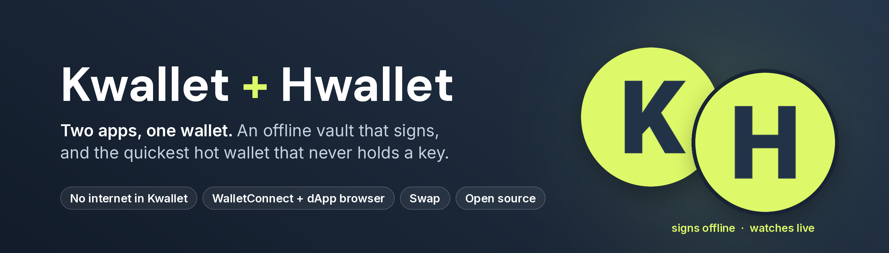

### An offline vault that signs, and the quickest hot wallet that never holds a key.

[](https://github.com/0xkabeno/Kwallet/releases/latest)
[](https://github.com/0xkabeno/Kwallet/actions/workflows/build.yml)
[](LICENSE)
[](hwallet/LICENSE)


[**Download**](#downloads) · [How it works](#how-signing-works) · [Features](#features) · [Fees](#fees) · [Security](#security-model) · [Build](#build-from-source)

</div>

---

## Two apps, one wallet

| | **Kwallet** — the vault | **Hwallet** — the hot wallet |
|---|---|---|
| Role | Fully secure offline wallet. Creates, stores and **signs** | The quickest hot wallet. Watches, prepares and **broadcasts** |
| Internet | **None.** The APK has no `INTERNET` permission | Public nodes for prices, balances, history and broadcast |
| Keys | Recovery phrases and private keys, encrypted on the device, never leave it | **Public addresses only.** Never sees a key |
| Signing | Every transaction, message and dApp request, on its own sign page: check every detail, tap Confirm | Asks Kwallet on the same phone (send, swap, WalletConnect, dApp browser) and waits for the signed result |
| Live data | Receives live fee, price and balance updates from Hwallet while its sign page is open | Live prices, balances, activity, incoming alerts, background service |
| License | MIT | GPL-3.0 (layout and tools follow Gem Wallet) |

Kwallet works alone, as an Android app or as one HTML file you open with the network unplugged. Add Hwallet on the same phone when you want a fast, live wallet without ever putting a key online.

## How signing works


Both apps must come from the same release (same signing key). Kwallet refuses any other caller, and Hwallet only accepts results from Kwallet.

## Screenshots

| | Hwallet home | Activity | Scanner | Settings | Kwallet sign page | Opening |
|---|---|---|---|---|---|---|
| **Light** | 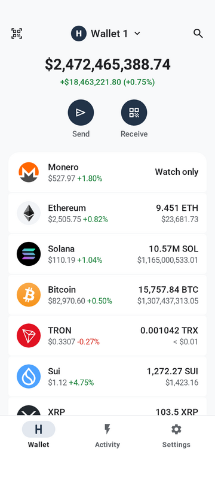 | 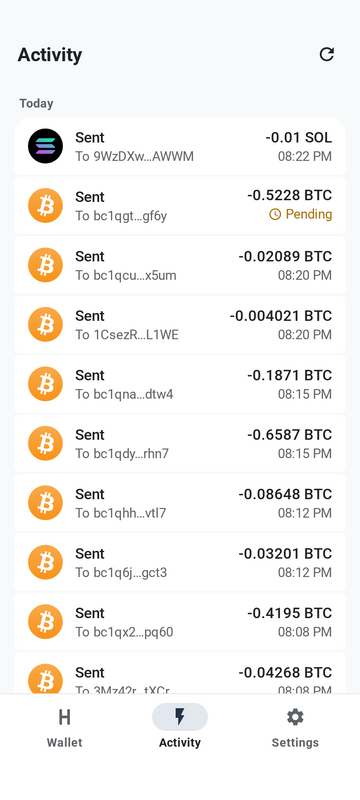 | 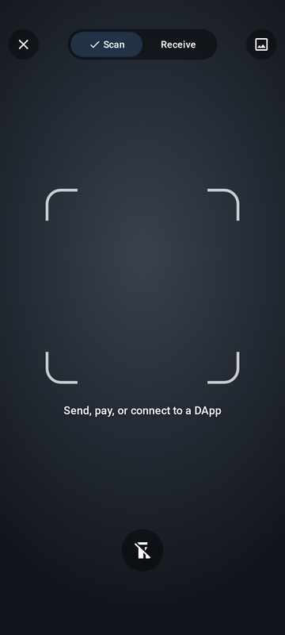 | 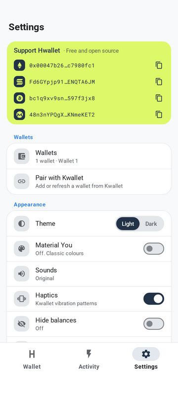 | 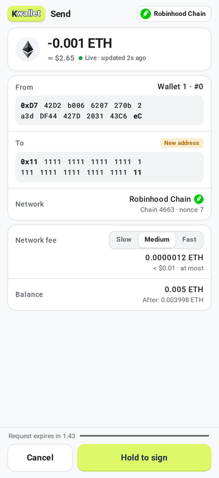 | 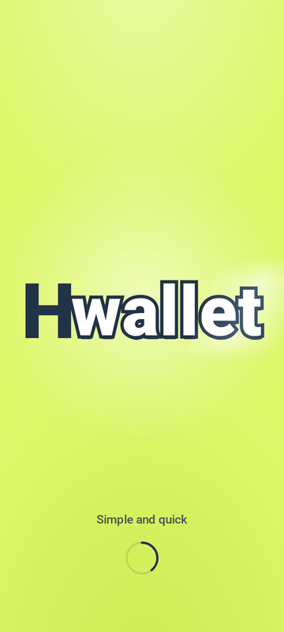 |
| **Dark** | 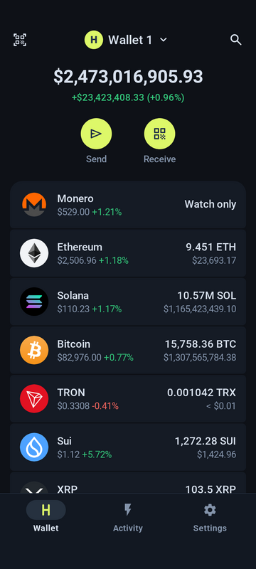 | 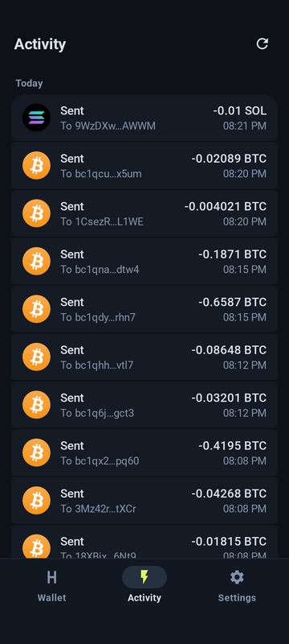 | 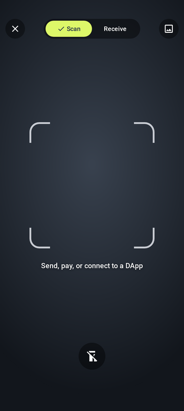 | 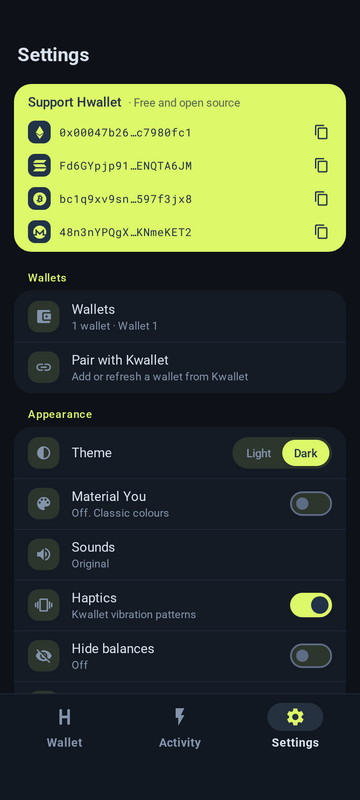 | 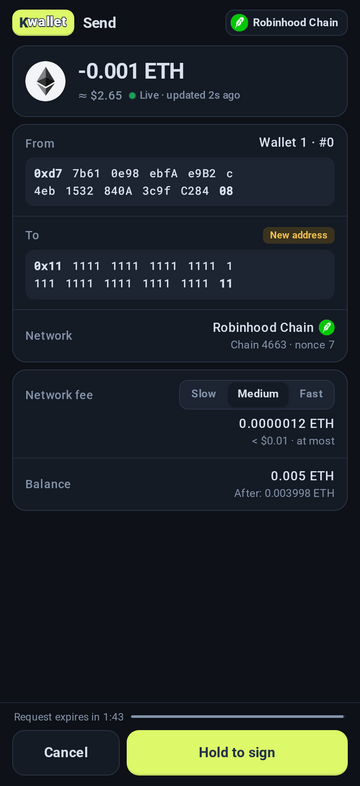 | 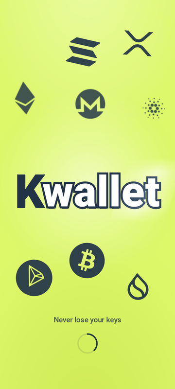 |

<sub>Taken from the v3.95 / v1.5 build with a public test address. The scanner shows a stand-in where the camera picture goes. v3.96 / v1.6 adds the Swap, Browser and WalletConnect screens.</sub>

## Features

### Kwallet — the offline vault

- **Generate or import** 12–24 word BIP39 phrases, with optional passphrase (25th word)
- **Find** — paste any address or part of one and Kwallet scans every common wallet path to locate it
- **Key** — paste a single private key to see its ETH, TRX, BTC and SOL addresses
- **Backup & restore** — full-state backup file, optionally AES-256-GCM encrypted (PBKDF2 600k)
- **Export** — PDF, CSV and JSON, saved to `Download/Kwallet` on Android
- **App lock** — 6-digit PIN, auto-lock timer, two-step *Erase everything*
- **Built-in self-test** — known-answer vectors for every chain in *Log → Verify*
- **Clipboard auto-clear**, haptics, light and dark themes, smooth 120 Hz scrolling
- **One sign sheet for everything** *(new in 3.97)* — every signature (Hwallet Send for every coin, Swap with its approvals, dApps, WalletConnect, fee withdrawals) opens as one translucent sheet over Hwallet, in Hwallet's navy/blue theme, light and dark. The title names the exact operation (Swap, Send, Approve, Revoke, Stake, Supply, Bridge, Sign-in, NFT listing…) and the card shows what leaves and what arrives, from a simulation where the chain allows it (Solana `simulateTransaction`, Tron constant calls, EVM decoding of Uniswap Universal Router, 1inch v6 and V3 routers)
- **Jupiter-style network fee sheet** *(new in 3.97)* — speed rows with the fee in the coin and in dollars (Solana: Site suggested / Faster / Fastest; EVM: Low / Normal / High with Gwei; Tron: Normal / Fast as "up to X TRX"), plus a Manual Custom section: *Transaction landing* Max Cap or Exact Fee, a Solana priority fee in SOL (no micro-lamports or compute units on screen), EVM max fee, priority fee and gas limit in Gwei, or a Tron fee limit in TRX, always with the live total in the coin and in dollars
- **Readable app requests** *(new in 3.97)* — known-program registries for Solana, EVM and Tron (SunSwap, SUN.io, JustLend, sTRX, Uniswap, 1inch, Seaport listings, Permit2 transfers); unknown programs are a quiet note under Details and red is kept for real risks (unlimited approvals to unknown spenders, nothing coming back in an NFT listing, a failing simulation)
- **Hwallet signer** — one sign page for every chain: decoded amounts, addresses in tidy blocks, live fee and balance, a fee-change re-arm, a countdown, and one tap on Confirm
- **dApp signing** *(new in 3.96)* — a calm bottom sheet for `personal_sign` (with a sign-in-with-Ethereum domain check), `eth_signTypedData_v4` (Permit / Permit2 decoded), `eth_sendTransaction` with ABI decode, Solana `signMessage` / `signTransaction` (v0 + lookup tables, instructions decoded) and Tron `signMessage` / smart-contract calls. The Kwallet chip and the chain chip are always in the header
- **Exact approvals** *(new)* — when an app asks for an unlimited ERC-20 or Permit2 allowance, Kwallet can re-encode it to the exact amount (Exact / Unlimited toggle with a clear warning); signed permits it can't change are flagged
- **Custom network fee** *(new)* — Slow / Normal / Fast / Custom on EVM (max fee, tip, gas limit), Solana (priority fee, compute units), Bitcoin (sat/vB) and Tron (fee limit), with the chain's live minimum and a warning when a custom value may stall or fail. It only changes the network fee
- **Settings and pairing as full pages** *(new)* — back arrow, Kwallet-branded, short and clear, with inline errors that say how to fix them
- **Never online** — no `INTERNET` permission; the HTML build works with the network unplugged

### Hwallet — the quickest hot wallet

- **dApps that just work** *(new in 1.7.2)* — Uniswap, 1inch, PancakeSwap, Stargate, Across, Jumper, Aave and OpenSea reach Kwallet's sheet on every EVM network and get the transaction hash back; Tron dApps (SunSwap, JustLend, SUN.io) get a working TronWeb; reads go to keyed fast nodes with short caches, and a connected site's chain is warmed when it opens
- **Safety, quietly** *(new in 1.7.2)* — Settings > Security > Token approvals lists every open EVM/Tron allowance and Solana delegate with one-tap Revoke; an address book with names; a look-alike (address poisoning) warning; "Unverified" / "Risky" token badges before a swap; pending / confirmed / failed notifications with a plain reason
- **Swap, tidier** *(new in 1.7.2)* — 25% / 50% / Max for every coin and token, best-route badge with the gain over the next provider, favourite and recent tokens first, live rent shown as one small red line, prices for every token
- **Home and lists** *(new in 1.7.2)* — fluid pull to refresh everywhere (and in the Browser), swipe a row to Pin or Hide, spam and dust hidden automatically
- **Quick sheets everywhere** *(new in 1.7)* — Send is a sheet for every coin, the connect popup and Kwallet's sign sheet share one design in Hwallet's own theme, and a multi-step swap shows a stepper (Approve → Swap → service fee) that stays on screen across the Kwallet sheets
- **Network fees your way** *(new in 1.7)* — the same Jupiter-style fee sheet on Send and in Swap settings: speed rows in the coin and dollars, and a Manual Custom section (Max Cap | Exact Fee; Solana priority fee and an optional Jito tip on Jupiter routes, in SOL; EVM max / priority fee in Gwei and gas limit; Tron fee limit in TRX)
- **Readable Activity** *(new in 1.7)* — tap any row for a plain sentence ("Swapped 1 USDC for 0.0077 SOL on Jupiter", "Sent 0.01 SOL to 7xK…3f", "Approved USDC for 0x11…a3", "Closed 2 token accounts"), the balance changes read from the chain, status, network fee, date and an Explorer button, on Solana, EVM networks and Tron
- **WalletConnect in the background** *(new in 1.7)* — the relay stays connected while Hwallet is in the background; a request shows a heads-up notification, one tap brings Hwallet forward with Kwallet's sheet already open, and after answering you go straight back to the dApp. A `wc:` link from a dApp opens Hwallet's connect sheet at once
- **Browser rebuilt** *(new in 1.7)* — pages load on every phone again, real icons for 20 popular dApps and every site's own favicon, History and Most visited, and Hwallet announces itself early (EIP-6963 and Solana Wallet Standard, mainnet by name and by CAIP-2 id) so Jupiter, Raydium, Uniswap and AppKit can list it
- **Reliable balances** *(new in 1.7)* — every EVM network, Solana (Token and Token-2022, any token you hold is added automatically) and Tron TRC-20; a slow node keeps the last value instead of dropping a token from your total; live swap quotes every 12 s with a countdown ring and a pull to refresh that always finishes
- **Gem dimensions** *(new in 1.7)* — list rows, 44 dp logos and badges, header, balance size and the round action buttons follow Gem Wallet's open-source layout; Settings > **API keys** is one row with its own page (Your key / Built-in / Keyless per provider)
- **WalletConnect** *(new in 1.6)* — Reown WalletKit for EVM networks, Solana and Tron: pair by scanning, pasting a `wc:` link or opening a deep link; connect, sign messages and typed data, approvals, contract calls and swaps, all signed in Kwallet; session list with disconnect in Settings
- **dApp browser** *(new)* — a Browser tab with unlimited tabs saved to the phone (history, scroll, a page snapshot) that reopen from storage with little data; injected EIP-1193 + EIP-6963 Ethereum provider, Solana Wallet Standard and a TronLink-style provider; per-site connections you can revoke
- **Swap** *(new)* — the best quote across NEAR Intents, Jupiter, LI.FI and SunSwap, in a Gem-style screen with a provider list, rate, minimum received, slippage (Auto or your own, with warnings) and an editable network fee. Every swap is signed in Kwallet; see [Fees](#fees)
- **Richer EVM history** *(new)* — Etherscan V2 and Alchemy with keyless Blockscout and RPC log-scan fallbacks; method names, approvals and swaps decoded; internal transfers included
- **Pull to refresh** *(new)* on Home, networks, coin pages and Activity
- **Notification coins** *(new)* — choose the four coins in the live notification from anything in the wallet, including tokens imported by contract
- **Your own API keys** *(new)* — optional Alchemy, Etherscan, Helius, TronGrid, LI.FI and Jupiter keys in Settings; Hwallet also works with none
- **Live everything** — prices, balances and full on-chain history (sent and received, endless scroll) on ETH and EVM networks (Base, Arbitrum, Optimism, Polygon, BNB Chain, Linea, Robinhood Chain, Arc), SOL, BTC, TRX, SUI, XRP and ADA, from free public nodes
- **Instant Activity** — a background service writes every chain's history to an on-device cache, so the tab opens with no network call
- **Own QR scanner** — CameraX with on-device decoding (no Google services): torch, scan from a photo, Scan / Receive tabs; addresses and payment links (`bitcoin:`, `ethereum:`, `solana:`, `tron:` with amount) open a prefilled Send
- **Clipboard paste chip** — Send offers "Paste <address> (Chain)" when you copied a valid address
- **Mobile data speed limit** — cap Hwallet's traffic on mobile data from 1 KB/s up to unlimited; **Wi-Fi is never limited**, and the limit switches live when the network changes
- **Gem-style design** with Kwallet's themes (light, dark, Material You), sounds and haptics; fixed bottom bar with a sliding pill; Settings as a full page
- **UI style** (Settings > UI style, in Hwallet and in Kwallet): **OG** (the classic look, default), **Material UI** (Material 3 shapes, type, controls, sheets and motion) or **Miuix** (Xiaomi HyperOS style after [compose-miuix-ui/miuix](https://github.com/compose-miuix-ui/miuix), Apache-2.0). Same screens and flows in all three; only Hwallet's navy / Kwallet's lime colours are kept. Kwallet's sign sheet over Hwallet follows Hwallet's style. *(3.97.5)* One shared skin compiled into both apps (identical dimensions), applied system wide: every screen, popup, list, menu and toast in both apps switches
- **Pull to refresh** in the selected style on Home, networks, token pages, Activity and in the Browser (every page, http too)
- **Several wallets**, tokens on every chain, TRON Energy / Bandwidth and Stake 2.0, XRP trust lines, Cardano native assets
- **Always-on service** with a live four-coin notification and incoming-payment alerts
- **Crash prompt** — if Hwallet ever closes unexpectedly, the next launch offers to copy the log (once per crash)
- **Monero, end to end** *(new in 1.8 / 3.98)* — the balance and history come from a view-key scan on the phone (monero-ts / wallet2 in WebAssembly, in a background worker): it starts at the wallet's restore height, keeps its cache on the phone and continues where it stopped, with a progress bar (% and blocks left). Receive with the main address or a new subaddress (QR), send with live fee levels: Hwallet builds the unsigned transaction, Kwallet signs it offline in the same sign sheet (CLSAG + Bulletproofs+, spend key never leaves Kwallet) after checking the recipient, amount and fee, Hwallet broadcasts it and imports the key images. Incoming XMR shows in Activity (with confirmations) and as a notification. Settings > Monero: node (automatic public HTTPS nodes or your own), scan start, sync spent status, rescan
- **Saved fee speed and a Jupiter-style recap** *(new in 1.8.1 / 3.98.1)* — the network fee speed you pick (Slow / Normal / Fast / Fastest / Custom) is remembered per chain and used in Send, Swap and every dApp / WalletConnect approval until you change it ("Site suggested" stays a choice on dApp sheets). Kwallet's dApp approvals and the Send review show a hero You send / You receive card, compact rows (rate, route, minimum received, fee with its speed), account rent as one small grey line with an info sheet, and one full-width Confirm in the style's own colour (OG lime in Kwallet / navy in Hwallet, Material You on Android 12+, Miuix blue)

- **Jupiter-style sheets, Inter and a single-line Settings** *(new in 1.8.2 / 3.98.2)* — every Confirm / Cancel is a pair of equal pills (Confirm green #ACF47D, Cancel red) in every style and theme; dApp and Send sheets are compact (one grouped balance-change card, fee and wallet cards, a grey trust line); the Inter typeface is bundled offline with tabular numbers and subscript zeros for tiny amounts (0.0₅6); Settings rows are single-line with the value on the right, regrouped (Wallets · Appearance · Sending & fees · Network incl. Monero · Security · Background & alerts · About) with a Saved fee speeds page; the Browser start page is compact and Most visited can be reordered by long-press and drag or trimmed with the small red x
- **One-tap signing, right-aligned amounts and a fixed scanner** *(new in 1.8.3 / 3.98.3)* — Confirm signs with one tap on every operation (PIN still applies if you turned it on); balance-change amounts sit flush right with a Rent row in the card when an account is opened; Hwallet hides its Send sheet while Kwallet signs, drops the first-time banner, tidies the To field buttons, and the QR scanner is a full opaque screen with a centred camera-off state
- **Monero pairing fix, seamless pairing, category Settings and one send check** *(new in 1.8.4 / 3.98.4)* — pairing from Hwallet now brings the Monero view key (old pairings are repaired; Hwallet offers Pair again when it is missing); one Pair with Kwallet button with steps, a success summary and fix buttons; Hwallet Settings are category rows with their own pages; Hwallet and Kwallet share one send check, so a Max token send (Solana and every other chain) can no longer be accepted by one app and refused by the other; Monero covers all of Kwallet's subaddresses and accounts
- **Swap Max that leaves only what the chain needs, and friendly swap errors** *(new in 1.8.5 / 3.98.5)* — 25% / 50% / Max use the spendable balance (fee + rent / reserve kept back per chain) and provider errors are one short note with a one-tap fix
- **Settings that clear the status bar, compact rows and a full-height Support card** *(new in 1.8.6 / 3.98.6)* — Settings sub-page headers sit below the Android status bar, rows are tighter, and the Support card fills the space down to the bottom bar with tap-to-copy rows
- **Sticky custom fees, one popup design, ad blocker and user agents** *(new in 1.8.7 / 3.98.7)* — a saved custom fee now holds on EVM dApps and WalletConnect too; every signing popup is one graphite sheet; the dApp browser blocks ads and trackers with uBlock Origin's lists and can present itself as another phone, tablet or desktop browser; Monero sends no longer freeze.
- **Snappy Monero, no size cap between the apps, on-phone page translation** *(new in 1.8.8 / 3.98.8, pre-release)* — Monero scans only the primary address + 2 subaddresses and talks to the node through Hwallet's native client; large Kwallet requests travel as files (no 400 kB cap); every sheet swipes down to close; the browser translates pages on the phone with Mozilla's Bergamot engine through one flashing toolbar icon, and has bookmarks and a one-tap desktop view.

- **No phantom Pending rows, instant translation, a browser that remembers, one layout for every style** *(new in 1.8.9 / 3.98.9, pre-release)* — a transaction shows as Pending only after Kwallet signed it and a node returned its id (abandoned dApp requests leave nothing, and old hashless rows are cleaned up once); dApp rows show the network's own coin and the decoded action; translation starts on tap for the whole page (viewport first) with the engine warmed early and a per-page cache; the last 3 tabs stay live and older ones reopen from a saved picture; capped, clearable browser storage; desktop view works with any user agent; every card and list has the same width and margins in OG, Material and MIUIX; Kwallet's dApp sheet gets a late preview in place instead of opening half-empty.

### Known limits (v3.98.9 / v1.8.9)

- Monero: the scan runs inside Hwallet (WebView worker); it continues in the background while Hwallet's always-on service keeps the app alive, and resumes from its saved cache when Hwallet is opened again after Android closed it. Nodes must be HTTPS (Android blocks plain http). The node learns your IP and which blocks you download, never your view key. The scan watches account 0: the primary address and subaddresses #1-#2 (or up to the paired index); funds sent to other accounts or higher subaddresses made elsewhere are not seen. Large Kwallet requests need Kwallet 3.98.8 or later. Monero needs Android System WebView 97 or later. The browser HTML builds have no Monero engine (it ships as `xmr/hwxmr.js` inside the APKs).
- Approve → Swap is two Kwallet sheets with Hwallet's stepper between them (no Permit2 / EIP-2612 signature path yet). Approvals are always for the exact amount and skipped when the allowance is already enough.
- The Jito tip is offered on Hwallet's own Jupiter swaps only; Kwallet never adds instructions to an app's transaction.
- Android does not let a background app open another app, so a WalletConnect request that arrives while you are elsewhere waits for one tap on its notification.
- The Tron browser provider is minimal (`tron_requestAccounts`, `trx.sign`, `signMessageV2`; no `tronWeb.contract()`). The browser's main page download is not throttled by the mobile-data cap (page resources are).
- Hwallet is not listed in the WalletConnect directory yet, so AppKit's own wallet list shows it only inside Hwallet's browser.

## Fees

Kwallet charges nothing. Hwallet's Swap adds a service fee, always shown on its own line in Details next to the provider fee and the network fee (none of them hidden; only the network fee is editable):

| Route | Service fee (Kwallet) | What you pay in total on top of the network fee |
|---|---|---|
| LI.FI | 0.3% | 0.3% + LI.FI's own provider fee |
| Jupiter | 0.3% on every pair (classic SPL and Token-2022; the fee token account is opened in the swap when missing) | 0.3% |
| SunSwap | 0.3%, sent as a separate transfer after the swap | 0.3% |
| NEAR Intents | 0.3% | 0.6% (NEAR Intents' 1Click takes an equal share) |

Network fees go to the blockchain, not to Kwallet. There is no referral or affiliate program.

## Supported chains

| Chain | Paths | Compatible with |
|---|---|---|
| **ETH / EVM** | `m/44'/60'/0'/0/i`, Ledger Live, Ledger legacy | MetaMask, Trust, Ledger |
| **BTC** | SegWit (84), Taproot (86), Nested SegWit (49), Legacy (44) | Electrum, Sparrow, BlueWallet |
| **SOL** | `m/44'/501'/i'/0'` and variants | Phantom, Solflare, Ledger |
| **TRX** | `m/44'/195'/0'/0/i`, Ledger Live | TronLink, Ledger |
| **SUI** | `m/44'/784'/i'/0'/0'` | Sui Wallet, Phantom, Slush |
| **XRP** | `m/44'/144'/0'/0/i` | Xaman, Trust |
| **ADA** | CIP-1852 (Icarus) | Yoroi, Eternl, Lace |
| **XMR** | Monero 25-word & Polyseed | Monero GUI, Cake, Feather |

Hwallet also follows EVM tokens on Base, Arbitrum, Optimism, Polygon, BNB Chain, Linea, Robinhood Chain and Arc.

## Downloads

Get the latest files from **[Releases](https://github.com/0xkabeno/Kwallet/releases/latest)**:

| File | What it is |
|---|---|
| [`Kwallet-vX.apk`](https://github.com/0xkabeno/Kwallet/releases/latest) | Kwallet for Android (no internet permission) |
| [`Kwallet-vX.html`](https://github.com/0xkabeno/Kwallet/releases/latest) | Kwallet as one HTML file: open it in any browser, offline |
| [`Hwallet-vX.apk`](https://github.com/0xkabeno/Kwallet/releases/latest) | Hwallet for Android (pairs with Kwallet on the same phone) |
| [`Hwallet-vX.html`](https://github.com/0xkabeno/Kwallet/releases/latest) | Hwallet in a browser (balances; signing needs the Android apps) |
| [`SHA256SUMS.txt`](https://github.com/0xkabeno/Kwallet/releases/latest) | Checksums for every file |

**Verify before you install:**

```bash
# put the downloads and SHA256SUMS.txt in one folder, then
sha256sum -c SHA256SUMS.txt --ignore-missing      # every line must say OK
# Android: both APKs must carry the same signing certificate
apksigner verify --print-certs Kwallet-v3.98.9.apk | grep SHA-256
apksigner verify --print-certs Hwallet-v1.8.9.apk  | grep SHA-256
```

On Android, open the APK and allow *Install unknown apps* once. Updates install over the previous version (same permanent key).

## Security model

- **Keys stay in Kwallet.** Phrases and private keys are encrypted at rest (AES-256-GCM, PIN or biometrics) and never leave the app. The Android build has no `INTERNET` permission, so it cannot send anything anywhere.
- **Hwallet is watch-only.** It stores public addresses and talks to public nodes. A compromised Hwallet can show wrong numbers, but it cannot sign: Kwallet decodes every request itself and shows what will really be signed.
- **dApps go through Kwallet too.** WalletConnect sessions and browser pages talk to Hwallet, never to keys; every signature they ask for opens Kwallet's sheet with the request decoded. Unlimited approvals default to the exact amount where they can be changed.
- **One caller, one key.** Kwallet only answers sign requests from an app signed with the same key, and the live-data channel is protected by a signature-level permission.
- **Check, then confirm.** The sign page shows the decoded chain, amounts, recipient, fee and balance; a fee change re-arms the button; requests expire.
- **Reproducible checks.** Every release runs 146 chain signer tests and 37 independent decode checks of Kwallet's signed output (ethers, @solana/web3.js, bitcoinjs-lib, ripple-binary-codec, cardano-serialization-lib, TronWeb, Sui SDK).

### The sign sheet's trust boundary (v3.97)

Kwallet's sign sheet opens over Hwallet as a translucent window in Hwallet's own task (an explicit, result-returning Android intent to `app.kwallet/.SignActivity`), so Hwallet stays visible and dimmed behind it and you come back to the exact same tab. Nothing about the offline model changes:

- **What crosses:** one request (the unsigned transaction or message, the app's name, URL, a small data: icon, the fee levels and prices Hwallet fetched) goes in as an intent extra; one result (the signature or signed transaction, or "rejected") comes back. Live fee and price updates use a broadcast that only apps signed with the Kwallet key can send. The key never leaves Kwallet.
- **What Kwallet trusts:** only the caller's identity (same signing certificate, checked on every request) and nothing it is told about the request's meaning. It decodes the raw transaction or message itself; app name, icon, "verified domain" and balance-change estimates from Hwallet are labels for you to judge, never inputs to what gets signed. A signed result is exactly what the sheet showed.
- **Still no `INTERNET`:** Kwallet has no network permission. Hwallet may wake Kwallet's process (a signature-protected `app.kwallet.WARM` broadcast that only loads the WebView engine on a blank page) so the sheet opens quickly; it carries no data.
- **The sheet cannot be covered:** other apps' overlays are hidden while it is open (Android 12+), touches through obscuring windows are ignored, and screenshots are blocked (`FLAG_SECURE`).
- **Pairing codes are unchanged:** pairing by `kwallet-pair:` code or QR (public addresses only, e.g. from Kwallet on another phone) works as before and does not use any of this.

See [SECURITY.md](SECURITY.md) to report a problem.

## Build from source

```bash
git clone https://github.com/0xkabeno/Kwallet.git && cd Kwallet
gradle assembleRelease                 # JDK 17, Android SDK, Gradle 8.9: builds both APKs
gradle :hwallet:testReleaseUnitTest    # Hwallet unit tests (speed limit, Wi-Fi gating)
```

- Kwallet's web app: [`web/index.html`](web/index.html), packed into the APK as-is.
- Hwallet's web app: [`hwallet/web/index.html`](hwallet/web/index.html); native shell in [`hwallet/app`](hwallet/app).
- Every push builds both APKs in **Actions**; every `v*` tag publishes a release with checksums.

## Credits and license

- **Kwallet** (`app/`, `web/`) is [MIT](LICENSE).
- **Hwallet** (`hwallet/`) is [GPL-3.0](hwallet/LICENSE). Its layout, scanner design and tools follow **[Gem Wallet](https://github.com/gemwalletcom/wallet)** (GPL-3.0), with thanks to the Gem team; coin and token logos come from the Gem and Trust Wallet asset repositories (MIT). See [`hwallet/NOTICE`](hwallet/NOTICE). Hwallet carries no Gem branding.
- QR decoding by [ZXing](https://github.com/zxing/zxing) (Apache-2.0); camera by AndroidX CameraX (Apache-2.0).
- The **Miuix** UI style and its pull-to-refresh follow **[Miuix](https://github.com/compose-miuix-ui/miuix)** by compose-miuix-ui (Apache-2.0); the **Material UI** style follows the [Material 3](https://m3.material.io) specification / androidx.compose.material3 tokens (Apache-2.0). See [`hwallet/NOTICE`](hwallet/NOTICE).

## Support

Kwallet and Hwallet are free and open source. If they saved you time, a tip keeps them going.

| Chain | Address |
|---|---|
| **ETH / EVM** | `0x00047b2663aB0cE43B6941E30247379Ac7980fc1` |
| **SOL** | `Fd6GYpjp91xkw1nR5teZuugfdUy7Kg6oKzZ4ENQTA6JM` |
| **BTC** | `bc1q9xv9snra9p3n6sqj5d6l0p6z22aesc597f3jx8` |
| **XMR** | `48n3nYPQgXTZYdrmdxiLkVYS41y9eXFf4RsSm9oXDvbcggNVP6Zzj5NSrNnWjQZcTtaaRJxfrQxVqBG5TNkSU4WKNmeKET2` |

The same addresses are in both apps under **Settings → Support**, one tap to copy.

## Disclaimer

Provided as-is, without warranty. You alone hold your keys: keep your recovery phrase offline and private, and test with small amounts first.

<div align="center"><sub>Kwallet MIT · Hwallet GPL-3.0</sub></div>
